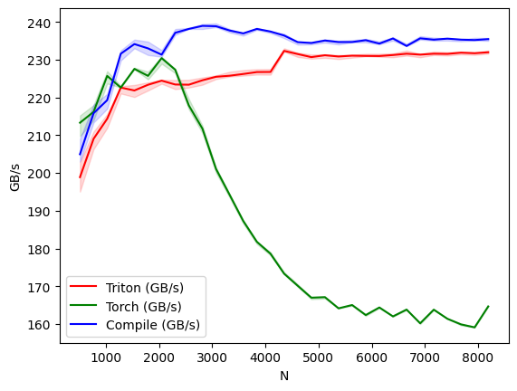
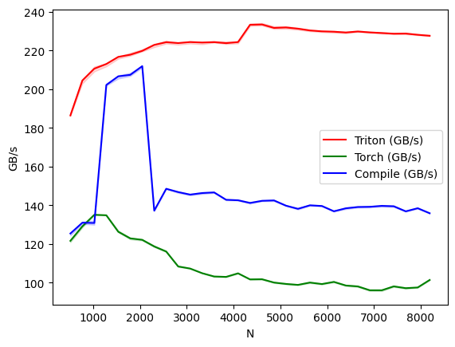

# Custom-RMSNorm-Kernel-And-Benchmark
A custom implementation of RMSNorm with both the forward and backward pass using a weight gradient buffer with atomic operations to reduce memory traffic. It has been validated against PyTorch across 31 hidden sizes, and benchmarked against both the PyTorch-eager and torch.compile versions of RMSNorm. The structure of the kernel is heavily inspired by the Triton LayerNorm tutorial (05-layer-norm).
# Overview
- Objective: Run a RMSNorm layer with forward and backward passes.
- Methodology: The forward pass implementation is standard. For the backward pass, minimize reads and writes by fusing the dx (input gradient) and dw (weight gradient) kernels. In addition, to speed up computation of the weight gradient, use atomic operations to write weight gradients to a buffer (with a lock) first, then sum the values of the buffer to get the total weight gradient.
- Benchmarking: Benchmarked against both the PyTorch-eager and torch.compile versions of RMSNorm.
# Tools and Libraries
- Python
- Triton
- PyTorch
# Benchmark Setup
- T4 GPU (Google Colab)
- Inputs are in fp16 precision
- M = 4096, N = 256 * {2, 3, ..., 32}
- GB/s calculation assumes 2 passes on a MxN tensor for forward and 3 for backward, ignoring smaller traffic like writing to dw_buffers and rstd
# Benchmark Results
## Forward Pass: 

Performs significantly better than PyTorch-eager for large N (>= 5000) and within ~6% of torch.compile.

## Backward Pass: 

Performs ~120% better than PyTorch-eager and ~60% better than torch.compile on large N (>= 5000).
